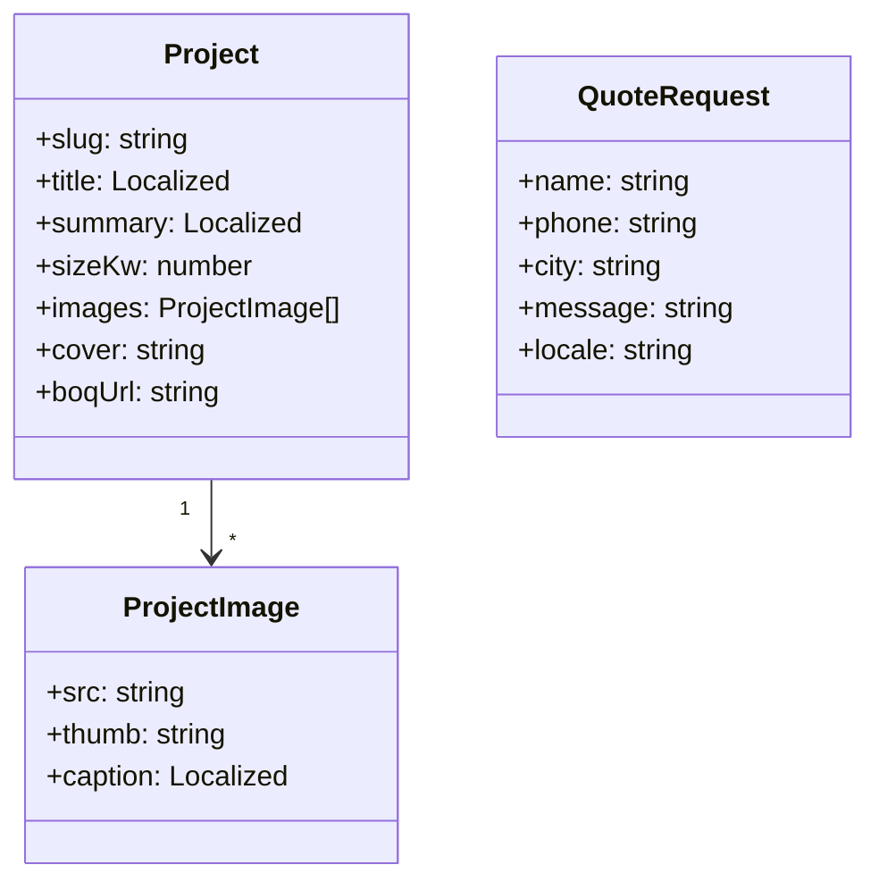
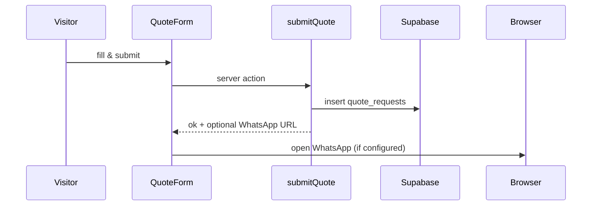

# Design Document — SolarLink

## 1. Architecture
Next.js App Router with two root layouts: `(site)/[lang]` (public, bilingual) and `admin` (separate root, noindex).

```
src/
  app/
    (site)/[lang]/          # public pages + privacy
    (admin)/admin/          # admin pages + auth
  components/               # Header, Hero, Services, HowWeWork, ProjectCard, About, Faq, QuoteForm, Gallery, Footer, admin/*
  lib/
    i18n.ts                 # bilingual dictionary
    data/projects.ts        # cached Supabase reads with fallback
    supabase/               # env, public, server, admin clients
    admin/                  # auth (DAL) + server actions
```

## 2. Class / data model (Mermaid)



## 3. Use cases
- Visitor browses projects and submits a quote request.
- Manager logs in, creates/edits a project, uploads photos, sets cover, attaches BOQ, publishes.
- Manager reviews quote requests and replies via WhatsApp.

## 4. Sequence: submit quote


## 5. Caching strategy
- `getPublishedProjects`, `getPublishedProject`, `getPublishedSlugs` use `use cache` + `cacheLife("hours")` + `cacheTag("projects")`.
- Admin mutations call `updateTag("projects")` and `revalidatePath` to refresh public pages.

## 6. Ethics / privacy
See `docs/ETHICS.md` and the privacy page at `/[lang]/privacy`.
```

## 7. Git workflow
GitHub Flow: `main` (protected) + `develop` + `feature/*` branches, PRs with review, conventional commits.
